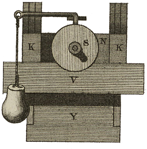

<div align="center" id="head">


<table>
<tr>
<td></td>
<td align="left">
<h1 style="margin:0">CompressSpeak</h1>
<p style="margin:0.25em 0 0"><strong>Opus-Kompression · Stimmisolation · Whisper-Transkription</strong></p>
</td>
</tr>
</table>

<a href="https://atelier.atechnologie.fr/" title="l'Atelier – Verein für Buchherstellung und Forschungswerkzeuge"></a>  
<sub>Entwickelt von <a href="https://atelier.atechnologie.fr/">l'Atelier</a> — Buchherstellung und Forschungswerkzeuge (EHESS)</sub>

<p>
🇫🇷 <a href="README.md">Français</a> ·
🇬🇧 <a href="README.en.md">English</a> ·
🇩🇪 <a href="README.de.md"><b>Deutsch</b></a> ·
🇪🇸 <a href="README.es.md">Español</a>
</p>

<p>
<a href="https://atelier.atechnologie.fr/"></a>
<a href="https://github.com/Atelier-Recherche/compressspeak"></a>
</p>

</div>

---

## Vorschau

| Oberfläche | Verarbeitung |
| :---: | :---: |
|  |  |

---

## Über das Projekt

**CompressSpeak** ist eine plattformübergreifende App (Windows / macOS / Linux) zur Sprach-Audiokompression und -bearbeitung in **Rust** (egui). Sie erzeugt leichte Opus-Dateien mit optionaler Reinigung, Mischung und Transkription.

## Funktionen

- **Opus-Kompression** über FFmpeg (afftdn-Rauschreduktion + Dynamikkompressor)
- **Native Stimmisolation** (UVR MDX-Net / ONNX Runtime, Voc_FT ~67 MB beim ersten Mal)
- **Eingebettete DPDF-Reinigung** (DPDFNet / ONNX Runtime)
- **Optionale Inworld-Reinigung** (Voice Isolator offline / ONNX Runtime, ~249 MB beim ersten Mal)
- **Eingebetteter Mix** (Rust-DSP: Wärme + Entdämpfung nach DPDF)
- **Transkription** über `whisper-cli` (ggml-Modelle)
- **Warteschlange**, integrierter Player, 5-s-Vorschau
- **Themes** dunkel / hell / System, **i18n** fr / en / de / es

---

## Voraussetzungen

- **Rust** stable (1.85+)
- **FFmpeg** im `PATH` oder gebündelt über `fetch-ffmpeg`
- Optional: [`whisper-cli`](https://github.com/ggerganov/whisper.cpp)

### Linux (UI-Abhängigkeiten)

```bash
sudo apt-get install libxcb-render0-dev libxcb-shape0-dev libxcb-xfixes0-dev \
  libxkbcommon-dev libssl-dev libasound2-dev
```

---

## Installation und Start

```bash
git clone https://github.com/Atelier-Recherche/compressspeak.git
cd compressspeak/compressspeak-rs
cargo run -p compressspeak
```

Release-Build:

```bash
cargo build --release -p compressspeak
# Binary: target/release/compressspeak[.exe]
```

### FFmpeg einbetten

```powershell
# Windows
.\scripts\fetch-ffmpeg.ps1
```

```bash
# macOS / Linux (Kopie aus PATH)
./scripts/fetch-ffmpeg.sh
```

---

## Nutzung

1. **Dateien hinzufügen** — Drag & Drop oder Button
2. **Gain** — dB pro Zeile
3. **Optionen** (Reihenfolge): Isolieren → Transkribieren → Mix → Reinigen
4. **Ausgabe** — Suffix, Ordner, FLAC behalten bei Isolation
5. **Nach Opus konvertieren** / **Alles verarbeiten** / **Transkribieren**

### Einstellungen

- **Opus-Konvertierung** — Presets Audiobook / Podcast / Voice Chat / Sprachnotiz
- **Mix** — Presets + optionale Entdämpfung (nach DPDF)
- **DPDF** — Sample-Rate + Modell
- **Whisper** — CLI-Pfad, Modell, Sprache, Format
- **UVR5** — CLI-/Modellpfad
- **Protokoll** — standardmäßig ausgeblendet

---

## Repository-Struktur

```
compressspeak/
├── compressspeak-rs/          # Rust-App (egui)
│   ├── crates/…
│   ├── assets/i18n
│   ├── scripts/
│   └── vendor/ffmpeg
├── archive/python/            # Alte PyQt6-Version (archiviert)
├── readme-media/
└── README.md
```

---

## Whisper / UVR5

Siehe die Abschnitte in der [englischen README](README.en.md) oder der [französischen README](README.md). Kurz: `whisper-cli` und optional `audio-separator` konfigurieren.

---

## Beitragen

UI-Texte: `compressspeak-rs/assets/i18n/strings.json`.

---

## Lizenz

[Noch festzulegen]

---

## Ressourcen

| | |
| --- | --- |
| **l'Atelier** | [atelier.atechnologie.fr](https://atelier.atechnologie.fr/) |
| **Repository** | [github.com/Atelier-Recherche/compressspeak](https://github.com/Atelier-Recherche/compressspeak) |

Die frühere Python-Version (PyQt6) liegt unter [`archive/python/`](archive/python/) und wird nicht mehr gepflegt.

---

<div align="center">

<sub>🇫🇷 <a href="README.md">Français</a> · <a href="README.en.md">🇬🇧 English</a> · <a href="README.de.md">🇩🇪 Deutsch</a> · <a href="README.es.md">🇪🇸 Español</a> · CompressSpeak — <a href="https://atelier.atechnologie.fr/">l'Atelier</a></sub>

</div>
