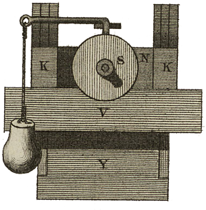

<div align="center" id="head">

<table>
<tr>
<td></td>
<td align="left">
<h1 style="margin:0">CompressSpeak</h1>
<p style="margin:0.25em 0 0"><strong>Opus compression · voice isolation · Whisper transcription</strong></p>
</td>
</tr>
</table>

<a href="https://atelier.atechnologie.fr/" title="l'Atelier – book-making and research tools association"></a>  
<sub>Developed by <a href="https://atelier.atechnologie.fr/">l'Atelier</a> — book-making and research tools (EHESS)</sub>

<p>
🇫🇷 <a href="README.md">Français</a> ·
🇬🇧 <a href="README.en.md"><b>English</b></a> ·
🇩🇪 <a href="README.de.md">Deutsch</a> ·
🇪🇸 <a href="README.es.md">Español</a>
</p>

<p>
<a href="https://atelier.atechnologie.fr/"></a>
<a href="https://github.com/Atelier-Recherche/compressspeak"></a>
</p>

</div>

---

## Preview

| Interface | Processing |
| :---: | :---: |
|  |  |

---

## About

**CompressSpeak** is a cross-platform (Windows / macOS / Linux) voice audio compression and processing app written in **Rust** (egui). It produces lightweight Opus files with optional cleaning, mixing, and transcription.

## Features

- **Opus compression** via FFmpeg (afftdn noise reduction + dynamic compressor)
- **Optional voice isolation** (UVR5 / `audio-separator`, external CLI)
- **Embedded DPDF cleaning** (DPDFNet / ONNX Runtime)
- **Embedded Mix** (Rust DSP: warmth + unmuffle after DPDF)
- **Transcription** via `whisper-cli` (ggml models)
- **Batch queue**, built-in player, 5 s preview
- **Themes** dark / light / system, **i18n** fr / en / de / es

---

## Prerequisites

- **Rust** stable (1.85+)
- **FFmpeg** on `PATH`, or bundled via `fetch-ffmpeg` scripts
- Optional: [`audio-separator`](https://github.com/nomadkaraoke/python-audio-separator) (UVR5), [`whisper-cli`](https://github.com/ggerganov/whisper.cpp) (transcription)

### Linux (UI deps)

```bash
sudo apt-get install libxcb-render0-dev libxcb-shape0-dev libxcb-xfixes0-dev \
  libxkbcommon-dev libssl-dev libasound2-dev
```

---

## Install and run

```bash
git clone https://github.com/Atelier-Recherche/compressspeak.git
cd compressspeak/compressspeak-rs
cargo run -p compressspeak
```

Release build:

```bash
cargo build --release -p compressspeak
# binary: target/release/compressspeak[.exe]
```

### Bundle FFmpeg

```powershell
# Windows
.\scripts\fetch-ffmpeg.ps1
```

```bash
# macOS / Linux (copy from PATH)
./scripts/fetch-ffmpeg.sh
```

---

## Usage

1. **Add files** — drag and drop or browse
2. **Gain** — adjust dB per row
3. **Per-file options** (task order): Isolate → Transcribe → Mix → Clean
4. **Output** — suffix, folder (default: next to sources), keep FLAC if isolating
5. **Convert to Opus** / **Process all** / **Transcribe**; progress bar at the bottom

### Settings

- **Opus conversion** — Audiobook / Podcast / Voice Chat / Voice note presets
- **Mix** — presets + optional unmuffle (after DPDF)
- **DPDF** — sample rate + model (Baseline / DPDFNet2 / 4 / 8)
- **Whisper** — CLI path, model, language, format (txt / srt / vtt)
- **UVR5** — CLI / model path (otherwise Isolate stays disabled)
- **Log** — hidden by default; enable in Settings

---

## Repository layout

```
compressspeak/
├── compressspeak-rs/          # Rust app (egui)
│   ├── crates/compressspeak   # UI
│   ├── crates/cs-core         # config, i18n, pipeline
│   ├── crates/cs-ffmpeg
│   ├── crates/cs-warmth       # Mix DSP
│   ├── crates/cs-dpdf         # DPDF / DPDFNet
│   ├── crates/cs-whisper
│   ├── crates/cs-uvr5
│   ├── assets/i18n
│   ├── scripts/               # fetch-ffmpeg
│   └── vendor/ffmpeg
├── archive/python/            # Legacy PyQt6 version (archived)
├── readme-media/
└── README.md
```

---

## Whisper

1. Install [whisper.cpp](https://github.com/ggerganov/whisper.cpp) / `whisper-cli`
2. Settings → Whisper transcription… → CLI path + model
3. `ggml-*.bin` models are downloaded into the app data directory

## UVR5

Not bundled. Install `audio-separator` and set the path in Settings → UVR5.

---

## Troubleshooting

### FFmpeg missing

Install FFmpeg (`winget install ffmpeg` on Windows) or run `scripts/fetch-ffmpeg` in `compressspeak-rs/`.

### Isolate disabled

UVR5 / `audio-separator` not found — install the CLI and configure the path in Settings.

### Transcription

Ensure `whisper-cli` is available and a model is selected in Settings.

---

## Contributing

1. Fork
2. Branch: `git checkout -b feature/my-feature`
3. Commit / push / Pull Request

UI strings live in `compressspeak-rs/assets/i18n/strings.json`.

---

## Licence

[To be defined]

---

## Acknowledgements

- **FFmpeg** — Opus encoding
- **egui / eframe** — UI
- **ONNX Runtime** / **Ceva DPDFNet** — cleaning
- **whisper.cpp** — transcription
- **audio-separator** / **UVR5** — optional isolation

---

## Contact

Open a GitHub issue.

---

## Resources

| | |
| --- | --- |
| **l'Atelier** | [atelier.atechnologie.fr](https://atelier.atechnologie.fr/) |
| **Repository** | [github.com/Atelier-Recherche/compressspeak](https://github.com/Atelier-Recherche/compressspeak) |

The legacy Python (PyQt6) version is kept in [`archive/python/`](archive/python/) for historical reference; it is no longer maintained.

---

<div align="center">

<sub>🇫🇷 <a href="README.md">Français</a> · <a href="README.en.md">🇬🇧 English</a> · <a href="README.de.md">🇩🇪 Deutsch</a> · <a href="README.es.md">🇪🇸 Español</a> · CompressSpeak — <a href="https://atelier.atechnologie.fr/">l'Atelier</a></sub>

</div>
