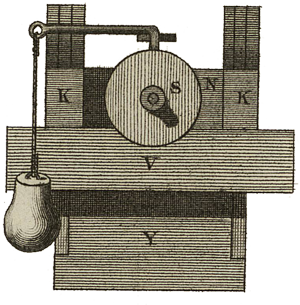

<div align="center" id="head">


<table>
<tr>
<td></td>
<td align="left">
<h1 style="margin:0">CompressSpeak</h1>
<p style="margin:0.25em 0 0"><strong>Compresión Opus · aislamiento de voz · transcripción Whisper</strong></p>
</td>
</tr>
</table>

<a href="https://atelier.atechnologie.fr/" title="l'Atelier – asociación de fabricación de libros y herramientas de investigación"></a>  
<sub>Desarrollado por <a href="https://atelier.atechnologie.fr/">l'Atelier</a> — fabricación de libros y herramientas de investigación (EHESS)</sub>

<p>
🇫🇷 <a href="README.md">Français</a> ·
🇬🇧 <a href="README.en.md">English</a> ·
🇩🇪 <a href="README.de.md">Deutsch</a> ·
🇪🇸 <a href="README.es.md"><b>Español</b></a>
</p>

<p>
<a href="https://atelier.atechnologie.fr/"></a>
<a href="https://github.com/Atelier-Recherche/compressspeak"></a>
</p>

</div>

---

## Vista previa

| Interfaz | Procesamiento |
| :---: | :---: |
|  |  |

---

## Acerca de

**CompressSpeak** es una aplicación multiplataforma (Windows / macOS / Linux) de compresión y tratamiento de audio de voz escrita en **Rust** (egui). Produce archivos Opus ligeros con limpieza, mezcla y transcripción opcionales.

## Funciones

- **Compresión Opus** con FFmpeg (reducción de ruido afftdn + compresor dinámico)
- **Aislamiento de voz** opcional (UVR5 / `audio-separator`, CLI externo)
- **Limpieza DPDF** integrada (DPDFNet / ONNX Runtime)
- **Mezcla** integrada (DSP Rust: calor + desafogue tras DPDF)
- **Transcripción** con `whisper-cli` (modelos ggml)
- **Cola por lotes**, reproductor integrado, vista previa de 5 s
- **Temas** oscuro / claro / sistema, **i18n** fr / en / de / es

---

## Requisitos

- **Rust** estable (1.85+)
- **FFmpeg** en el `PATH`, o embebido con los scripts `fetch-ffmpeg`
- Opcional: [`audio-separator`](https://github.com/nomadkaraoke/python-audio-separator) (UVR5), [`whisper-cli`](https://github.com/ggerganov/whisper.cpp)

### Linux (dependencias de UI)

```bash
sudo apt-get install libxcb-render0-dev libxcb-shape0-dev libxcb-xfixes0-dev \
  libxkbcommon-dev libssl-dev libasound2-dev
```

---

## Instalación y ejecución

```bash
git clone https://github.com/Atelier-Recherche/compressspeak.git
cd compressspeak/compressspeak-rs
cargo run -p compressspeak
```

Build release:

```bash
cargo build --release -p compressspeak
# binario: target/release/compressspeak[.exe]
```

### Embeber FFmpeg

```powershell
# Windows
.\scripts\fetch-ffmpeg.ps1
```

```bash
# macOS / Linux (copia desde PATH)
./scripts/fetch-ffmpeg.sh
```

---

## Uso

1. **Añadir archivos** — arrastrar o botón
2. **Ganancia** — dB por fila
3. **Opciones** (orden): Aislar → Transcribir → Mezcla → Limpiar
4. **Salida** — sufijo, carpeta, conservar FLAC si se aísla
5. **Convertir a Opus** / **Procesar todo** / **Transcribir**

### Ajustes

- **Conversión Opus** — presets Audiobook / Podcast / Voice Chat / Nota de voz
- **Mezcla** — presets + desafogue opcional (tras DPDF)
- **DPDF** — sample rate + modelo
- **Whisper** — ruta CLI, modelo, idioma, formato
- **UVR5** — ruta CLI / modelo
- **Registro** — oculto por defecto

---

## Estructura del repositorio

```
compressspeak/
├── compressspeak-rs/          # App Rust (egui)
│   ├── crates/…
│   ├── assets/i18n
│   ├── scripts/
│   └── vendor/ffmpeg
├── archive/python/            # Versión PyQt6 archivada
├── readme-media/
└── README.md
```

---

## Whisper / UVR5

Configure `whisper-cli` y, si lo desea, `audio-separator` en Ajustes. Detalles en el [README en francés](README.md) o [en inglés](README.en.md).

---

## Contribuir

Cadenas de UI: `compressspeak-rs/assets/i18n/strings.json`.

---

## Licencia

[Por definir]

---

## Recursos

| | |
| --- | --- |
| **l'Atelier** | [atelier.atechnologie.fr](https://atelier.atechnologie.fr/) |
| **Repositorio** | [github.com/Atelier-Recherche/compressspeak](https://github.com/Atelier-Recherche/compressspeak) |

La antigua versión Python (PyQt6) está en [`archive/python/`](archive/python/) y ya no se mantiene.

---

<div align="center">

<sub>🇫🇷 <a href="README.md">Français</a> · <a href="README.en.md">🇬🇧 English</a> · <a href="README.de.md">🇩🇪 Deutsch</a> · <a href="README.es.md">🇪🇸 Español</a> · CompressSpeak — <a href="https://atelier.atechnologie.fr/">l'Atelier</a></sub>

</div>
