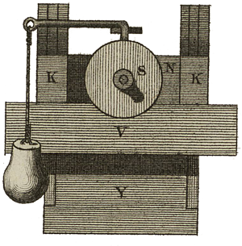

<div align="center" id="head">


<table>
<tr>
<td></td>
<td align="left">
<h1 style="margin:0">CompressSpeak</h1>
<p style="margin:0.25em 0 0"><strong>Compression Opus · isolation vocale · transcription Whisper</strong></p>
</td>
</tr>
</table>

<a href="https://atelier.atechnologie.fr/" title="l'Atelier – Association de fabrication de livres et d'outils de recherche"></a>  
<sub>Développé par <a href="https://atelier.atechnologie.fr/">l'Atelier</a> — fabrication de livres et outils de recherche (EHESS)</sub>

<p>
🇫🇷 <a href="README.md"><b>Français</b></a> ·
🇬🇧 <a href="README.en.md">English</a> ·
🇩🇪 <a href="README.de.md">Deutsch</a> ·
🇪🇸 <a href="README.es.md">Español</a>
</p>

<p>
<a href="https://atelier.atechnologie.fr/"></a>
<a href="https://github.com/Atelier-Recherche/compressspeak"></a>
</p>

</div>

---

## Aperçu

| Interface | Traitement |
| :---: | :---: |
|  |  |

---

## À propos

**CompressSpeak** est une application multiplateforme (Windows / macOS / Linux) de compression et traitement audio pour la voix, écrite en **Rust** (egui). Elle produit des fichiers Opus légers avec nettoyage, mixage et transcription optionnelle.

## Fonctionnalités

- **Compression Opus** via FFmpeg (réduction de bruit afftdn + compresseur dynamique)
- **Isolation vocale** optionnelle (UVR5 / `audio-separator`, CLI externe)
- **Nettoyage DPDF** embarqué (DPDFNet / ONNX Runtime)
- **Mixage** embarqué (DSP Rust : chaleur + désourdage après DPDF)
- **Transcription** via `whisper-cli` (modèles ggml)
- **File d’attente** par lots, lecteur intégré, aperçu 5 s
- **Thèmes** sombre / clair / système, **i18n** fr / en / de / es

---

## Prérequis

- **Rust** stable (1.85+)
- **FFmpeg** dans le `PATH`, ou embarqué via les scripts `fetch-ffmpeg`
- Optionnel : [`audio-separator`](https://github.com/nomadkaraoke/python-audio-separator) (UVR5), [`whisper-cli`](https://github.com/ggerganov/whisper.cpp) (transcription)

### Linux (dépendances UI)

```bash
sudo apt-get install libxcb-render0-dev libxcb-shape0-dev libxcb-xfixes0-dev \
  libxkbcommon-dev libssl-dev libasound2-dev
```

---

## Installation et lancement

```bash
git clone https://github.com/Atelier-Recherche/compressspeak.git
cd compressspeak/compressspeak-rs
cargo run -p compressspeak
```

Build release :

```bash
cargo build --release -p compressspeak
# binaire : target/release/compressspeak[.exe]
```

### Embarquer FFmpeg

```powershell
# Windows
.\scripts\fetch-ffmpeg.ps1
```

```bash
# macOS / Linux (copie depuis le PATH)
./scripts/fetch-ffmpeg.sh
```

---

## Utilisation

1. **Ajouter des fichiers** : glisser-déposer ou bouton d’ajout
2. **Gain** : ajuster le dB par ligne
3. **Options par fichier** (ordre de tâche) : Isoler → Transcrire → Mixage → Nettoyer
4. **Sortie** : suffixe, dossier (sinon à côté des sources), conserver FLAC si isolation
5. **Convertir en Opus** / **Tout traiter** / **Transcrire** ; barre de progression en bas

### Paramètres

- **Conversion Opus** : presets Audiobook / Podcast / Voice Chat / Note vocale
- **Mixage** : presets + désourdage optionnel (après DPDF)
- **DPDF** : sample rate + modèle (Baseline / DPDFNet2 / 4 / 8)
- **Whisper** : chemin CLI, modèle, langue, format (txt / srt / vtt)
- **UVR5** : chemin CLI / modèle (sinon « Isoler » reste désactivé)
- **Journal** : masqué par défaut, activable dans Paramètres

---

## Structure du dépôt

```
compressspeak/
├── compressspeak-rs/          # Application Rust (egui)
│   ├── crates/compressspeak   # UI
│   ├── crates/cs-core         # config, i18n, pipeline
│   ├── crates/cs-ffmpeg
│   ├── crates/cs-warmth       # Mixage DSP
│   ├── crates/cs-dpdf         # DPDF / DPDFNet
│   ├── crates/cs-whisper
│   ├── crates/cs-uvr5
│   ├── assets/i18n
│   ├── scripts/               # fetch-ffmpeg
│   └── vendor/ffmpeg
├── archive/python/            # Ancienne version PyQt6 (archivée)
├── readme-media/
└── README.md
```

---

## Whisper

1. Installer [whisper.cpp](https://github.com/ggerganov/whisper.cpp) / `whisper-cli`
2. Paramètres → Transcription Whisper… → chemin CLI + modèle
3. Les modèles `ggml-*.bin` sont téléchargés dans le dossier data de l’app

## UVR5

Non embarqué. Installez `audio-separator` et indiquez le chemin dans Paramètres → UVR5.

---

## Dépannage

### FFmpeg introuvable

Installez FFmpeg (`winget install ffmpeg` sous Windows) ou lancez `scripts/fetch-ffmpeg` dans `compressspeak-rs/`.

### Isolation désactivée

UVR5 / `audio-separator` non détecté : installez le CLI et configurez le chemin dans Paramètres.

### Transcription

Vérifiez que `whisper-cli` est accessible et que le modèle est sélectionné dans Paramètres.

---

## Contribuer

1. Fork
2. Branche : `git checkout -b feature/ma-feature`
3. Commit / push / Pull Request

Les chaînes UI sont dans `compressspeak-rs/assets/i18n/strings.json`.

---

## Licence

[À définir]

---

## Remerciements

- **FFmpeg** — compression Opus
- **egui / eframe** — interface
- **ONNX Runtime** / **Ceva DPDFNet** — nettoyage
- **whisper.cpp** — transcription
- **audio-separator** / **UVR5** — isolation vocale (optionnel)

---

## Contact

Ouvrez une issue sur GitHub.

---

## Ressources

| | |
| --- | --- |
| **l'Atelier** | [atelier.atechnologie.fr](https://atelier.atechnologie.fr/) |
| **Dépôt** | [github.com/Atelier-Recherche/compressspeak](https://github.com/Atelier-Recherche/compressspeak) |

L’ancienne version Python (PyQt6) est conservée dans [`archive/python/`](archive/python/) pour référence historique ; elle n’est plus maintenue.

---

<div align="center">

<sub>🇫🇷 <a href="README.md">Français</a> · <a href="README.en.md">🇬🇧 English</a> · <a href="README.de.md">🇩🇪 Deutsch</a> · <a href="README.es.md">🇪🇸 Español</a> · CompressSpeak — <a href="https://atelier.atechnologie.fr/">l'Atelier</a></sub>

</div>
